<p align="center">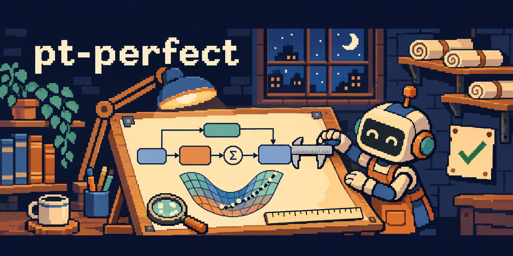</p>

<h1 align="center">pt-perfect</h1>

<p align="center">An agent skill for paper figures that are correct at the printed point.<br>
Pixel-perfect is for screens. Papers are <b>pt-perfect</b>.</p>

<p align="center"><a href="README.zh-CN.md">简体中文</a> · <a href="#install">Install</a> · <a href="#what-it-draws">Gallery</a> · <a href="#themes">Themes</a> · <a href="#same-skill-different-models">Comparison</a> · <a href="LICENSE">MIT</a></p>

---

`pt-perfect` is a skill for coding agents (Claude Code, Codex, and other agents that load `SKILL.md` skills). It ships a small React + SVG toolkit and the design rules to use it, so an agent can turn a paper's text, equations and code into a method figure, an architecture breakdown or a mechanism figure, and hand back editable source plus a size-exact PDF, SVG and PNG.

Hand-written absolute coordinates are why generated figures keep breaking: a subscript pushes a formula out of its box, a label is centred by eye, a wire runs through text after one node moves. The kit removes those failures by construction:

- **Units are printed points.** The canvas is as wide as the figure will be printed (for example 174 mm). `size: 7.5` is 7.5 pt on paper.
- **Measure first, then place.** Text and TeX are measured with the real font files and MathJax before anything gets a position; positions come from neighbouring boxes.
- **A geometry audit, without a browser.** Overflow, label overlap, wires through objects, endpoints off their borders, short arrow tails, undersized text, near-miss alignment. Errors stop the export.
- **Checked export.** Chrome prints the vector PDF; the report records the exact page box, embedded fonts and the difference between measured and rendered text width.
- **Design rules, not only an API.** Three reference guides tell the agent how to compose each kind of figure and what to check by eye.

## What it draws

| Kind | Guide | Example source |
| --- | --- | --- |
| Method / framework figure | [`composition.md`](skills/pt-perfect/references/composition.md) | [`template/figure.tsx`](skills/pt-perfect/assets/template/figure.tsx) |
| Module figure: a network opened up layer by layer | [`module-figures.md`](skills/pt-perfect/references/module-figures.md) | [`vit-module.tsx`](skills/pt-perfect/assets/examples/vit-module.tsx) |
| Mechanism figure: the core idea, with vector 3D scenes | [`mechanism-figures.md`](skills/pt-perfect/references/mechanism-figures.md) | [`context-mechanism.tsx`](skills/pt-perfect/assets/examples/context-mechanism.tsx) |

**Mechanism figure** — one scene drawn three times with a single change per panel. The 3D is plain SVG paths (depth-sorted quads), so it stays vector and editable.

<p align="center"></p>

**Module figure** — overview, block, operator; colour marks the block type across layers.

<p align="center">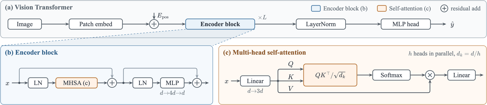</p>

Both are 174 mm wide, pass the audit with 0 errors and 0 warnings, and are built from the example sources above.

## Themes

A theme changes colours, type and rendering (fills, shadows, panel titles), not the layout. Tone names (`blue`, `orange`, ...) are semantic slots that every preset fills, so the same source switches theme without edits. Below are the two gallery figures in each preset.

<table>
<tr>
<td width="50%" align="center"><br>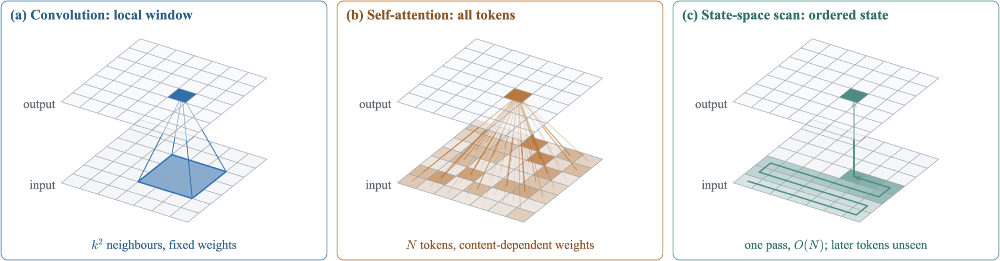<br><b><code>pastel</code></b> (default)</td>
<td width="50%" align="center">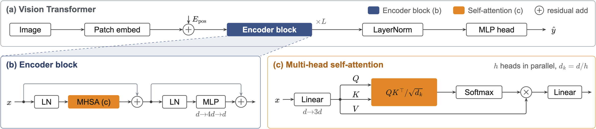<br>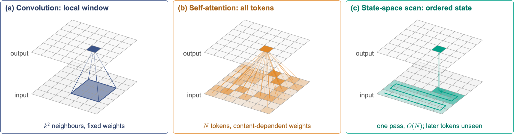<br><b><code>navy</code></b></td>
</tr>
<tr>
<td width="50%" align="center">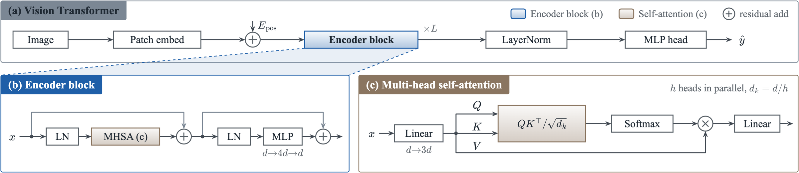<br>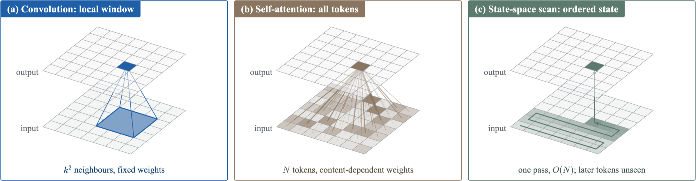<br><b><code>slate</code></b></td>
<td width="50%" align="center">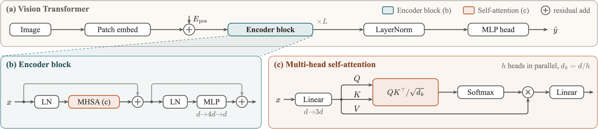<br>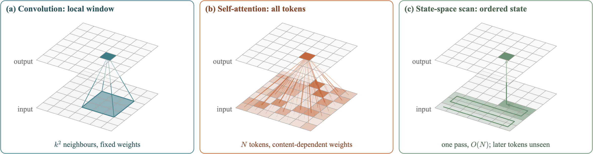<br><b><code>terracotta</code></b></td>
</tr>
<tr>
<td width="50%" align="center">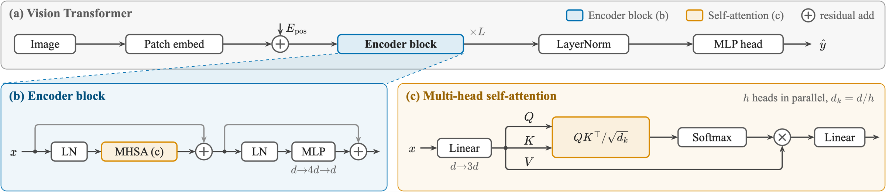<br>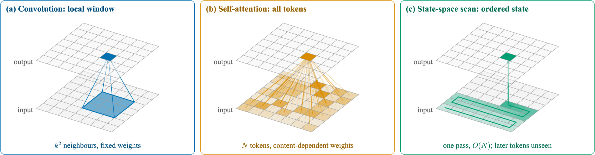<br><b><code>okabe-ito</code></b></td>
<td width="50%" align="center">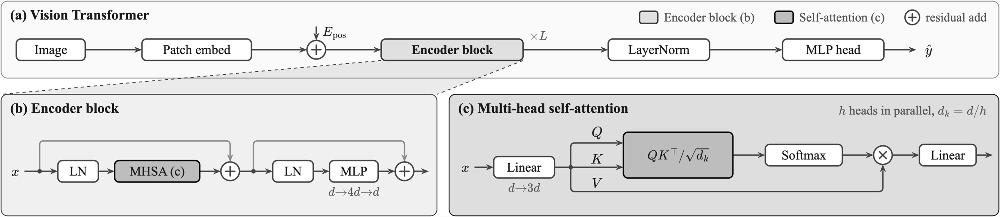<br>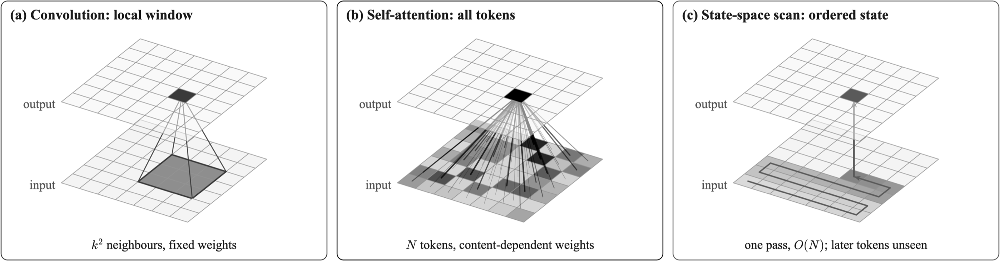<br><b><code>mono</code></b></td>
</tr>
</table>

```tsx
theme: 'navy',   // or ['navy', t => { ... }] to adjust; or `npm run build -- --theme navy`
```

Presets and their uses are listed in [`toolkit.md`](skills/pt-perfect/references/toolkit.md). Palette references: [ggsci](https://github.com/nanxstats/ggsci) (NPG) for `navy` and Okabe–Ito for `okabe-ito`; some preset ideas come from [Yuan1z0825/nature-skills](https://github.com/Yuan1z0825/nature-skills) and [mikubaka88/CCFA-Skills](https://github.com/mikubaka88/CCFA-Skills).

## Same skill, different models

The task: recreate Fig. 2 of *3DSMT: A Hybrid Spiking Mamba-Transformer for Point Cloud Analysis* at 174 mm from the figure image alone. Topology, module names and signal names follow the original; colours, fonts and icons follow the skill's defaults.

<table>
<tr>
<td width="50%" align="center">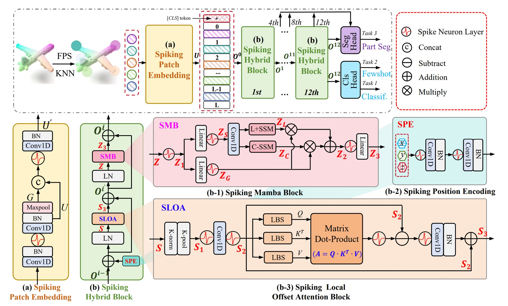<br><b>Original</b> (paper figure)</td>
<td width="50%" align="center">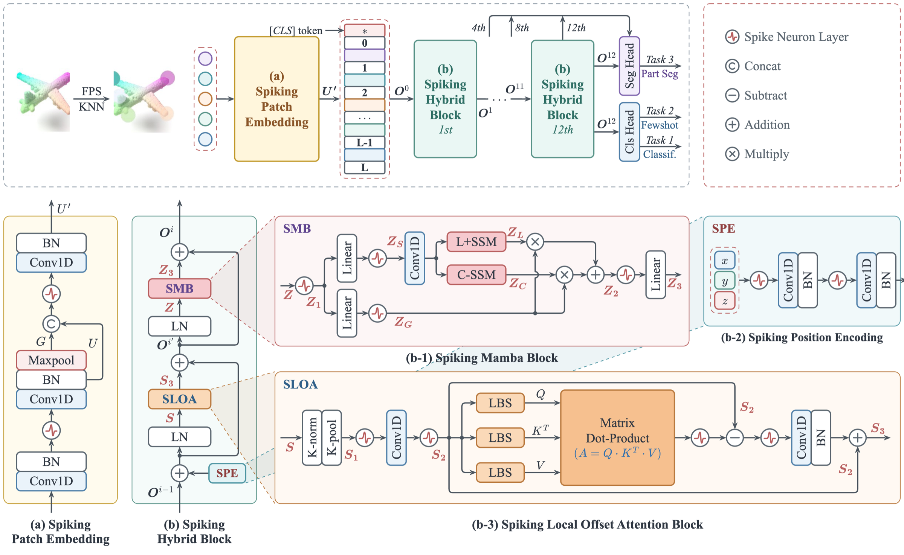<br><b>Claude Fable 5.2</b></td>
</tr>
<tr>
<td width="50%" align="center">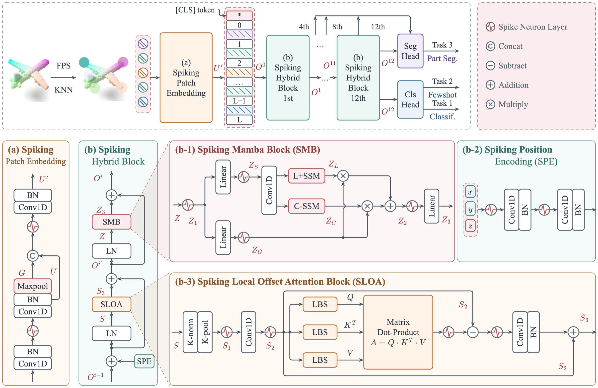<br><b>gpt-6.1-sol</b></td>
<td width="50%" align="center">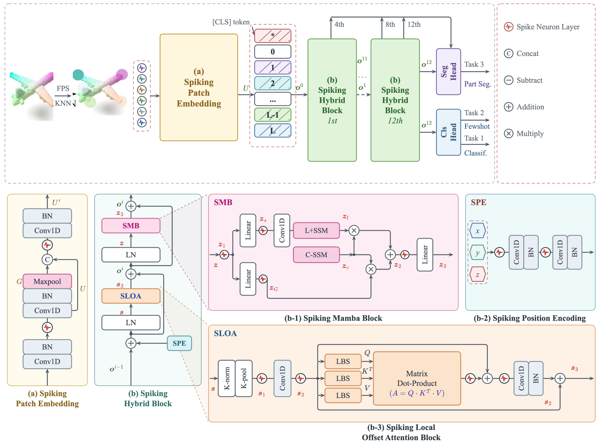<br><b>DeepSeek Flash 4.1</b></td>
</tr>
</table>

<sub>The original figure belongs to its authors and is shown here only for comparison.</sub>

## Install

Copy the skill folder to where your agent looks for skills.

```sh
git clone https://github.com/Anduin9527/pt-perfect
# Claude Code (user-level; use .claude/skills/ inside a repo for project-level)
cp -R pt-perfect/skills/pt-perfect ~/.claude/skills/
# Codex
cp -R pt-perfect/skills/pt-perfect ~/.codex/skills/
```

Then ask for a figure: *"Use pt-perfect to draw the method figure for this paper at 174 mm."*

Requirements: Node.js 20 or newer; Google Chrome or Chromium for PDF/PNG export (set `CHROME_PATH` if it is not in a standard location); optionally poppler (`pdffonts`, `pdftoppm`) for the font-embedding check. `npm run build` (SVG + audit) needs no browser.

## Use the kit by hand

```sh
cp -R skills/pt-perfect/assets/template/. my-figure/ && cp -R skills/pt-perfect/assets/kit my-figure/kit
cd my-figure && npm install
npm run build     # SVG, exports/audit.json, exports/preview.html
npm run export    # PDF + PNG + exports/export-report.json
```

```tsx
import { defineFigure, port, right, type Scene } from './kit';

export default defineFigure({
  name: 'figure', widthMM: 174, title: 'Pipeline', desc: 'Encoder feeds the predictor.',
  draw(s: Scene) {
    const a = s.node('enc', { lines: ['Encoder $f_\\theta$'], tone: 'grey', x: 0.5, y: 0.5 });
    const b = s.node('pred', { lines: ['Predictor $g_\\phi(x_t, t)$'], tone: 'orange', x: right(a) + 40, y: 0.5, h: a.h });
    s.wire('w', [port(a, 'right'), port(b, 'left')], { from: 'enc', to: 'pred' });
    return a.h + 1; // figure height in pt
  },
});
```

To run an example, copy it over `figure.tsx`. The full API is in [`toolkit.md`](skills/pt-perfect/references/toolkit.md).

## Layout of this repository

```
skills/pt-perfect/
  SKILL.md              workflow and conventions the agent follows
  references/           composition, module figures, mechanism figures, toolkit API
  assets/kit/           the toolkit (measure, scene, space, audit, cli)
  assets/template/      starting project
  assets/examples/      complete figures
docs/images/            images used in this README
```

## Scope and limits

- For diagrams, not for quantitative plots (use matplotlib or similar and embed the result as a tile).
- The audit proves the absence of mechanical defects. Whether the figure is scientifically right, reads in a natural order and looks good still has to be judged by looking at it; the guides say what to look for.
- Items inside a 3D `Space` scene and zoom callouts are not audited.
- The skill's guides are written in Chinese; agents read them as they are. The code, comments and API names are in English.
- Tested on macOS with Node 24 and Google Chrome. Linux font fallbacks (Liberation Serif, Nimbus Roman) are configured but not tested.

## License

MIT. The header image was generated with an image model through the Codex CLI.
