<p align="center"></p>

<h1 align="center">pt-perfect</h1>

<p align="center">面向编码智能体的论文插图技能：按印刷磅值保证正确。<br>
屏幕讲究像素级精确，论文讲究<b>磅值级精确</b>。</p>

<p align="center"><a href="README.md">English</a> · <a href="#安装">安装</a> · <a href="#能画什么">图例</a> · <a href="#主题">主题</a> · <a href="#同一技能不同模型">对比</a> · <a href="LICENSE">MIT</a></p>

---

`pt-perfect` 是一个供编码智能体（Claude Code、Codex 以及其他能加载 `SKILL.md` 的智能体）使用的技能。它包含一个小型 React + SVG 工具包和配套的设计规则，使智能体能够依据论文的正文、公式和代码绘制方法图、网络结构展开图和机理图，并交付可编辑的源码以及尺寸精确的 PDF、SVG、PNG。

手写绝对坐标是生成的插图反复出错的根源：下标把公式撑出边框，标签靠目测居中，移动一个节点后连线穿过文字。工具包从结构上消除这些问题：

- **单位即印刷磅值。** 画布宽度等于最终印刷宽度（例如 174 mm），`size: 7.5` 就是纸面上的 7.5 pt。
- **先测量，后定位。** 文字与 TeX 公式先用真实字体文件和 MathJax 测量，再确定位置；位置由相邻对象的边框推导。
- **不依赖浏览器的几何审计。** 检查越界、标签重叠、连线穿过对象、端点未落在边框、箭头末段过短、字号过小、近似对齐等问题；存在错误时停止导出。
- **带核对的导出。** 由 Chrome 输出矢量 PDF；报告记录页面尺寸、字体嵌入情况，以及文字实测宽度与预测宽度之差。
- **提供设计规则，而不只是接口。** 三份参考文档说明每类图的构图方法和需要目视检查的内容。

## 能画什么

| 类型 | 参考文档 | 范例源码 |
| --- | --- | --- |
| 方法图、框架图 | [`composition.md`](skills/pt-perfect/references/composition.md) | [`template/figure.tsx`](skills/pt-perfect/assets/template/figure.tsx) |
| 模块图：把网络逐层展开 | [`module-figures.md`](skills/pt-perfect/references/module-figures.md) | [`vit-module.tsx`](skills/pt-perfect/assets/examples/vit-module.tsx) |
| 机理图：阐述核心思想，支持矢量三维场景 | [`mechanism-figures.md`](skills/pt-perfect/references/mechanism-figures.md) | [`context-mechanism.tsx`](skills/pt-perfect/assets/examples/context-mechanism.tsx) |

**机理图**：同一场景绘制三次，每个面板只改变一处。三维部分由普通 SVG 路径构成（按深度排序的四边形），因此保持矢量且可编辑。

<p align="center">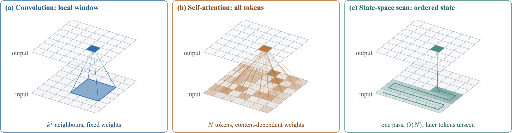</p>

**模块图**：总览、块、算子三层；颜色在各层之间标识同一类型的块。

<p align="center">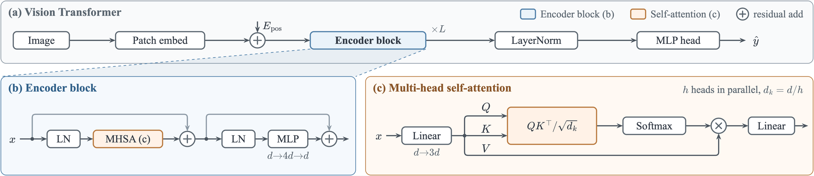</p>

两张图宽度均为 174 mm，几何审计结果为 0 错误、0 警告，由上表中的范例源码构建。

## 主题

主题改变颜色、字体和渲染方式（填充、阴影、面板标题的样式），不改变版面。色调名（`blue`、`orange` 等）是语义槽位，每个预设都会填满，因此同一份源码无需修改即可切换主题。下图为上文两张示例图在各预设下的效果。

<table>
<tr>
<td width="50%" align="center"><br><br><b><code>pastel</code></b>（默认）</td>
<td width="50%" align="center">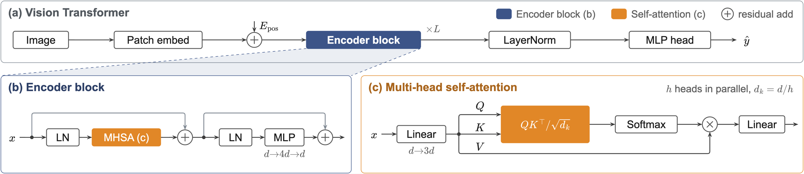<br>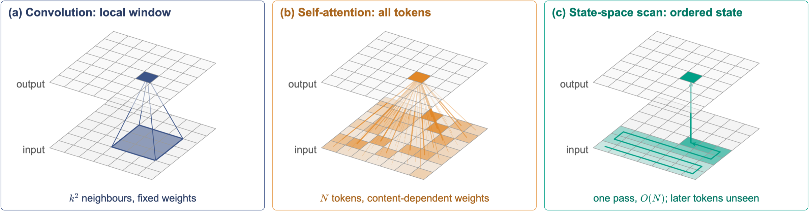<br><b><code>navy</code></b></td>
</tr>
<tr>
<td width="50%" align="center">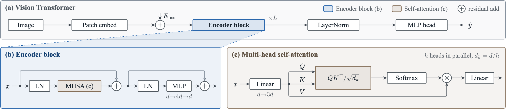<br>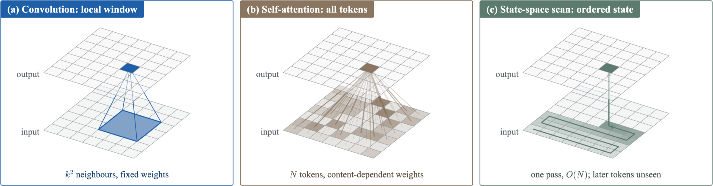<br><b><code>slate</code></b></td>
<td width="50%" align="center">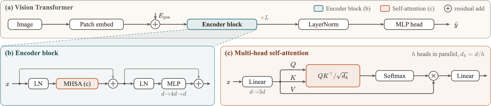<br>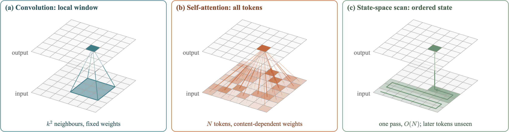<br><b><code>terracotta</code></b></td>
</tr>
<tr>
<td width="50%" align="center">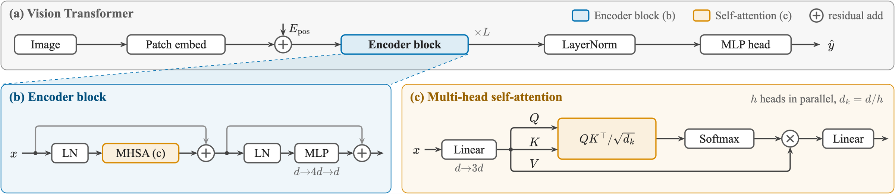<br>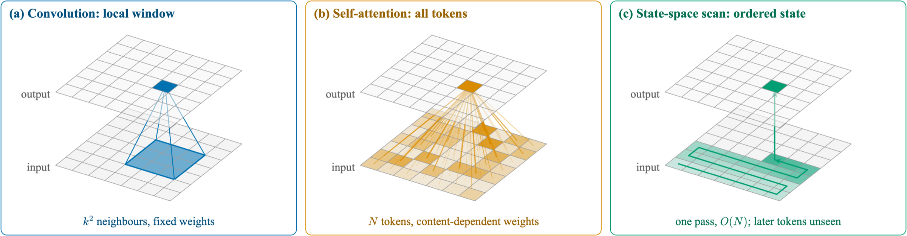<br><b><code>okabe-ito</code></b></td>
<td width="50%" align="center">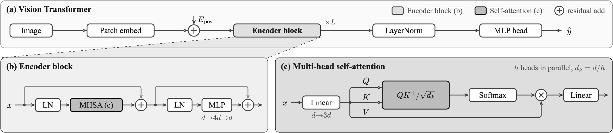<br>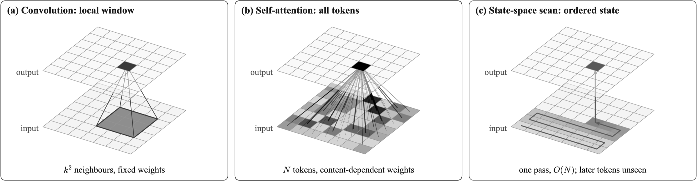<br><b><code>mono</code></b></td>
</tr>
</table>

```tsx
theme: 'navy',   // 或 ['navy', t => { ... }] 再做调整；也可用 `npm run build -- --theme navy`
```

各预设的用途见 [`toolkit.md`](skills/pt-perfect/references/toolkit.md)。配色参考：`navy` 的色相取自 [ggsci](https://github.com/nanxstats/ggsci) 的 NPG 配色，`okabe-ito` 即 Okabe–Ito 色盲友好配色；部分预设的思路来自 [Yuan1z0825/nature-skills](https://github.com/Yuan1z0825/nature-skills) 与 [mikubaka88/CCFA-Skills](https://github.com/mikubaka88/CCFA-Skills)。

## 同一技能，不同模型

任务：仅依据论文插图的图像，按 174 mm 宽度复刻 *3DSMT: A Hybrid Spiking Mamba-Transformer for Point Cloud Analysis* 的 Fig. 2。拓扑、模块名与信号名依照原图；配色、字体与图标采用技能的默认样式。

<table>
<tr>
<td width="50%" align="center">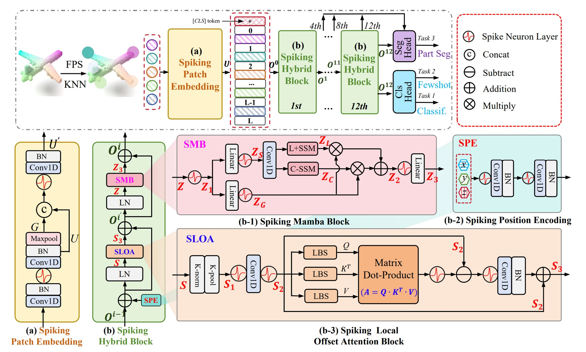<br><b>原图</b>（论文插图）</td>
<td width="50%" align="center">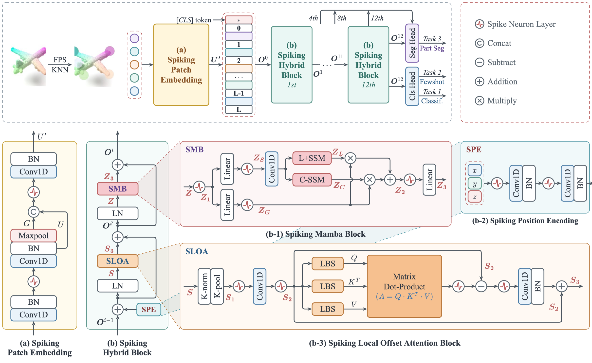<br><b>Claude Fable 5.2</b></td>
</tr>
<tr>
<td width="50%" align="center">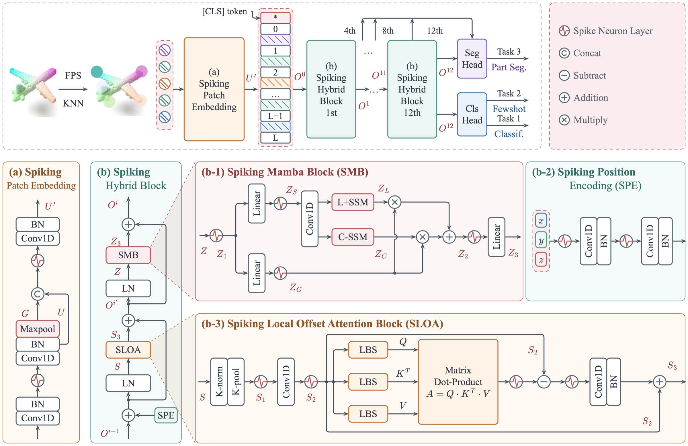<br><b>gpt-6.1-sol</b></td>
<td width="50%" align="center">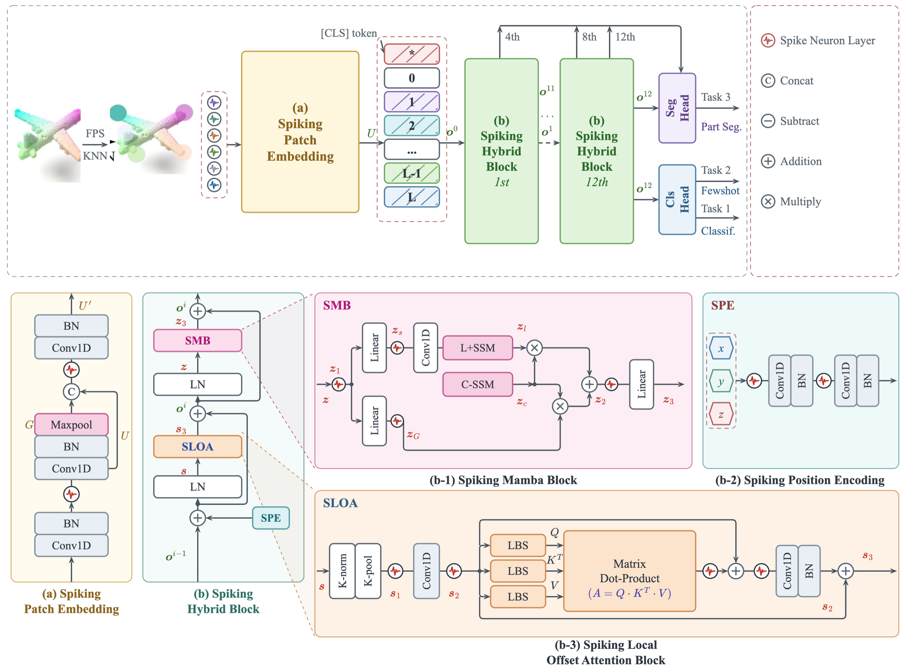<br><b>DeepSeek Flash 4.1</b></td>
</tr>
</table>

<sub>原图版权归其作者所有，此处仅用于对比。</sub>

## 安装

```sh
npx skills add Anduin9527/pt-perfect
```

该命令会为检测到的智能体（Claude Code、Codex、Cursor 等）安装技能。

然后直接提出需求，例如：“使用 pt-perfect 按 174 mm 宽度绘制这篇论文的方法图。”

环境要求：Node.js 20 及以上；导出 PDF 和 PNG 需要 Google Chrome 或 Chromium（不在标准位置时设置 `CHROME_PATH`）；字体嵌入检查可选用 poppler（`pdffonts`、`pdftoppm`）。`npm run build`（生成 SVG 并审计）不需要浏览器。

## 手动使用工具包

```sh
cp -R skills/pt-perfect/assets/template/. my-figure/ && cp -R skills/pt-perfect/assets/kit my-figure/kit
cd my-figure && npm install
npm run build     # SVG、exports/audit.json、exports/preview.html
npm run export    # PDF、PNG、exports/export-report.json
```

```tsx
import { defineFigure, port, right, type Scene } from './kit';

export default defineFigure({
  name: 'figure', widthMM: 174, title: 'Pipeline', desc: 'Encoder feeds the predictor.',
  draw(s: Scene) {
    const a = s.node('enc', { lines: ['Encoder $f_\\theta$'], tone: 'grey', x: 0.5, y: 0.5 });
    const b = s.node('pred', { lines: ['Predictor $g_\\phi(x_t, t)$'], tone: 'orange', x: right(a) + 40, y: 0.5, h: a.h });
    s.wire('w', [port(a, 'right'), port(b, 'left')], { from: 'enc', to: 'pred' });
    return a.h + 1; // 图的高度，单位 pt
  },
});
```

运行范例时，用范例文件覆盖 `figure.tsx`。完整接口见 [`toolkit.md`](skills/pt-perfect/references/toolkit.md)。

## 仓库结构

```
skills/pt-perfect/
  SKILL.md              智能体遵循的工作流程与约定
  references/           构图、模块图、机理图、工具包接口
  assets/kit/           工具包（测量、场景、三维、审计、命令行）
  assets/template/      起始工程
  assets/examples/      完整范例
docs/images/            本说明使用的图片
```

## 适用范围与限制

- 用于示意图，不用于定量统计图（统计图用 matplotlib 等工具绘制后作为图块嵌入）。
- 审计只能证明不存在机械缺陷。科学内容是否正确、阅读顺序是否自然、是否美观，仍需看图判断；参考文档列出了检查要点。
- 三维场景（`Space`）内部的图元和放大引线不参与审计。
- 技能的参考文档以中文撰写，智能体可直接阅读；代码、注释与接口名为英文。
- 已在 macOS、Node 24、Google Chrome 下测试。Linux 的字体回退（Liberation Serif、Nimbus Roman）已配置，未经测试。

## 许可

MIT。头图由图像模型经 Codex CLI 生成。
